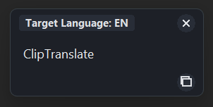
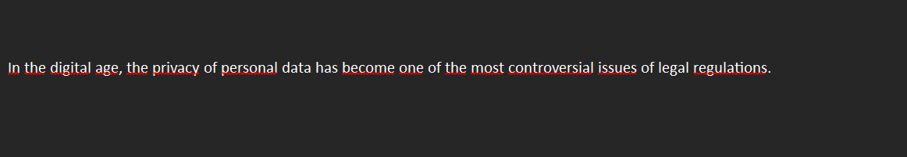
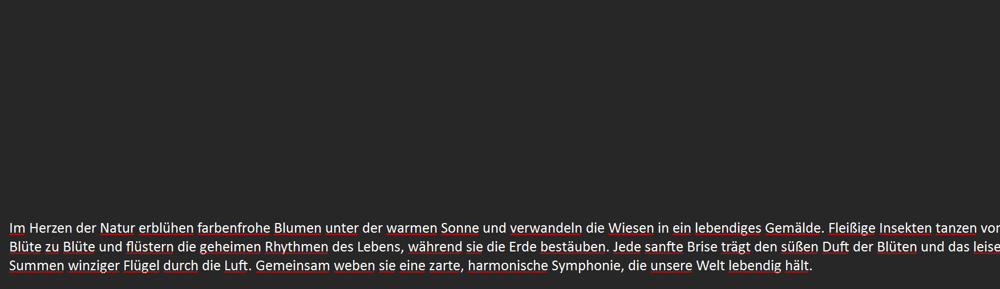

 

# ⚠️ Warning

Since this application interferes slightly with the keyboard, you may be blocked and banned by Anti-cheat applications. Please use at your own risk.

# ClipTranslate

### Description

**ClipTranslate** is a lightweight translation application for Windows. It instantly translates the selected text into your preferred language using the shortcut **Ctrl + Shift + X**. If Auto-Paste is active, it automatically copies the translated result to the clipboard and pastes it back into the active application. If Auto Paste is not active, the translation window will open when you press **Ctrl + Shift + X**.

## Installation

Open the **ClipTranslate.exe** application you downloaded

## Features

- Instantly translates the selected text into your preferred target language.
- It automatically copies and translates the translated text, if Auto Paste is active, it copies it to the text location. If not, it writes the translated text to the Translation Window.
- When AutoPaste is active, it works in almost any application where text can be selected and copied, including games, web browsers, Discord, Notepad, Visual Studio Code and more.
- Supports changing the **target translation language** directly from the system tray.
- Can be started automatically with Windows.
- Can send optional desktop notifications after each successful translation.
- Translation can be enabled or disabled directly from the system tray without closing the application.
- Supports **20 interface languages** that can be changed from the system tray.
- It is lightweight and uses resources efficiently; typically uses less than **50 MB** of RAM.

### Translation Window Features

- When the Auto Paste setting is turned off, you can open it anywhere by pressing Ctrl + Shift + X.
- It has a built-in copy button.
- Works wherever text can be selected.
- It does not turn off unless the cross **(×)** icon is pressed.
- The Translation Window that opens after the translation is made, only changes the data and size if the translation is made again without closing it.

>***You can turn the Auto Paste setting on/off by left-clicking on the application in the system tray.***

## Usage

>Auto Paste usage:

>Translation Window usage:

1. Start **ClipTranslate**.
2. Type or select the text you want to translate.
3. Press **Ctrl + Shift + X**.
4. ClipTranslate will automatically:
   - Copies the selected text,
   - Translates the selected text into the target language,
   - Copies the translated text to the clipboard,
   - The Translation Window opens and the translated text is written in it. If Auto Paste is active, it pastes the text where it is written,
   - Restores the clipboard before the translation process started.
5. If notifications are enabled, the notification **"Text translated and copied to clipboard"** will appear.

The selected text will be replaced with its translated version automatically.
